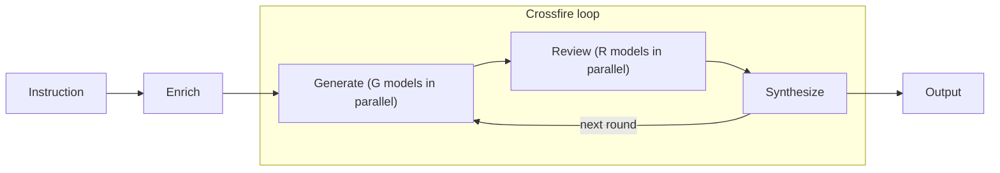

# Crossfire

Crossfire is a multi-agent adversarial refinement orchestrator, which means: it sends your prompt to multiple LLMs to generate text or code, reviews each generated artefact multiple times by different LLMs, and then merges the best pieces into one refined artefact.
That _generation → review → synthesis_ loop is repeated as many times as you want.
Crossfire implements a [multi-start evolutionary search with delayed selection](https://ianreppel.org/ralph-wiggum-as-a-degenerate-evolutionary-search/), or an improved [Ralph Wiggum](https://ghuntley.com/ralph/) method.

## Architecture



Each round runs _generation → review → synthesis_ sequentially; within generation and review, model calls run in parallel.
Rounds repeat until the configured limit or until reviewers find no material weaknesses (early stop).
Here, "material" means substantive issues like factual errors, logic flaws, or broken code, not style issues or nitpicks.
Each mode (research, code, edit, check, write) has its own review protocol: rubber duck debugging for code, precision review for editing, literary criticism for writing, and so on.

## How to use
### Prerequisites

- Python 3.12
- [uv](https://docs.astral.sh/uv/) for dependency management

### Install

```bash
uv python install 3.12         # transitive incompatibility in docformatter->untokenize
uv venv --python 3.12
uv sync
```

### Set up API keys

Crossfire uses OpenCode Zen by default. Select another gateway with `--provider` or the `provider` key in `crossfire.toml`.

| Provider | Key |
|:---------|:----|
| `opencode` and `opencode-go` | `OPENCODE_API_KEY` |
| `openrouter` | `OPENROUTER_API_KEY` |
| `synthetic` | `SYNTHETIC_API_KEY` |

```bash
export OPENCODE_API_KEY="..."
export OPENROUTER_API_KEY="sk-or-..."
export SYNTHETIC_API_KEY="syn-..."
export TAVILY_API_KEY="tvly-..."      # only needed if search.enabled = true in crossfire.toml
```

### Run

```bash
uv run crossfire run \
  --mode research \
  --instruction "Compare error correction strategies for superconducting vs trapped-ion qubits" \
  --num-generators 2 \
  --num-reviewers-per-candidate 3 \
  --num-rounds 5
```

### CLI options

| Flag | Description | Default |
|:-----|:------------|:--------|
| `--mode` | One of `research`, `code`, `edit`, `check`, `write` | — |
| `--instruction` | Task instruction (mutually exclusive with `--instruction-file`) | — |
| `--instruction-file` | Read instruction from a file (mutually exclusive with `--instruction`) | — |
| `--context-file` | Supplementary reference material (see below) | none |
| `--num-generators` | Generators per round | 1 |
| `--num-reviewers-per-candidate` | Reviewers assigned to each candidate | 3 |
| `--num-rounds` | Number of rounds | 3 |
| `--enrich / --no-enrich` | Enrich instruction via a lightweight model before generation | true |
| `--early-stop / --no-early-stop` | Stop early when reviewers find no material weaknesses | true |
| `--early-stop-threshold` | Weakness threshold for early stopping | 1 |
| `--verbose`, `-v` | Show JSON log events | false |
| `--output` | Additional path to write the final output to | none |
| `--run-dir` | Archive directory for all run artifacts | `runs/<timestamp>` |
| `--config` | Path to `crossfire.toml` | auto-detected |
| `--provider` | `opencode`, `opencode-go`, `openrouter`, or `synthetic` | `crossfire.toml` value (`opencode`) |
| `--dry-run` | Simulate without network calls | false |

#### Instruction vs context
The `--instruction` (or `--instruction-file`) is the **task**: what you want Crossfire to do.
The `--context-file` is **reference material**: source text, code to review, data to analyse.
They are separated because the pipeline treats them differently:
- The instruction is _never_ compressed, even when the full prompt exceeds the token budget.
  Context may be trimmed if the prompt doesn't fit the model's context window.
- The enricher rewrites the instruction into a richer brief but leaves the context untouched.
- Prompts place them in distinct sections so the LLMs know which is which.

```bash
# Short instruction + long reference document
uv run crossfire run \
  --mode research \
  --instruction "Summarize the key findings and identify methodological weaknesses" \
  --context-file paper.pdf
```

### Cost estimation
Cost estimation in ``--dry-run`` requires current model prices.
`crossfire prices` fetches prices from OpenRouter and models.dev (OpenCode Zen, OpenCode Go, and Synthetic) and stores them in `pricing.json`:

```bash
uv run crossfire prices
```

Prices are keyed by gateway, so `--provider` selects the matching rates.
Both catalogues are fetched wholesale, so you can edit `crossfire.toml` without re-fetching.

### Clean up
Remove all generated and cached files (runs, `.venv`, caches, bytecode):

```bash
uv run crossfire clean        # interactive
uv run crossfire clean --yes  # skip yes/no prompts
```

This deletes `runs/`, `.venv/`, `.ruff_cache/`, `.pytest_cache/`, `.mypy_cache/`, `__pycache__/` dirs, `*.pyc` files, and packaging artefacts (`dist/`, `build/`, `*.egg-info/`).
`clean` refuses to run unless it finds a `crossfire.toml` in the current directory, so a mistaken `cd` cannot nuke an unrelated project's `.venv`.
After cleaning, run `uv sync` to recreate the virtual environment.

## Modes

| Mode | Focus |
|---|---|
| `research` | Structured research with citations and verification of claims |
| `code` | Production code and associated tests with systematic rubber duck debugging review |
| `edit` | Precision editing with systematic anti-waffle and jargon elimination |
| `check` | Accuracy and logical validity checking |
| `write` | Creative writing with literary criticism and sceptical review |

### Model configuration
Each mode can override the global `[models.*]` defaults via `[modes.<mode>.*]` sections in `crossfire.toml`.
Only roles that differ need to be specified.
Any missing roles fall back to the global default.

Cross-group overlap is allowed: a model may both generate and review in the same round, as they do not share prompts or contexts.

Model names in `[models.*]` are neutral slugs.
`[providers.<name>.model_ids]` maps them to each gateway's wire IDs.
A model ID has a provider pin when it starts with a configured provider name followed by a colon.
The pin restricts the model to runs that use the named gateway.
Prefixes such as `hf:` and `syn:` remain part of the model ID unless a provider with that name is configured.
OpenRouter's trailing `:free` suffix stays in the model ID and is not treated as a provider pin.
The wire ID is the model ID Crossfire sends to the selected gateway after removing the provider pin and resolving aliases.
Synthetic's `syn:*` aliases keep the call stable when its routed model changes.

## Configuration
Crossfire is configured via `crossfire.toml` at the project root.
The file defines four model groups (`enricher`, `generators`, `reviewers`, `synthesizer`), each with a list of model IDs, a context window, and maximum output tokens.
Per-mode overrides go in `[modes.<mode>.*]` sections.

See [`crossfire.toml`](crossfire.toml) for the full configuration with all 5 modes, per-model context window overrides, and detailed comments explaining the model selection rationale.

OpenRouter and Synthetic use OpenAI-compatible chat. OpenCode Zen and Go choose chat, messages, or responses by model family.

### Data policy
Crossfire applies gateway-specific data-use checks and logs known retention terms.
The controls differ by gateway:
- [`openrouter`](https://openrouter.ai/docs/guides/routing/provider-selection)
  - Every request carries `provider.data_collection: "deny"` and `provider.zdr: true`.
  - The two request fields constrain provider routing.
  - OpenRouter stores no prompts unless users opt in to Input & Output Logging or to product-improvement use of their inputs.
- [`opencode`](https://opencode.ai/docs/zen/#privacy)
  - By default, Crossfire refuses runs that use a model whose input data OpenCode Zen may use for training or model improvement.
  - OpenCode Zen offers no per-request controls over retention or data use for training or model improvement.
- [`opencode-go`](https://opencode.ai/docs/go/#privacy)
  - By default, Crossfire refuses runs that use a model in Crossfire's OpenCode Go training table.
  - OpenCode Go offers no per-request controls over retention or data use for training.
  - OpenCode Go retains prompts for 30 days for Grok 4.7, GPT-6 Luna, GPT-5.6 Luna, Claude Haiku 5.5, and Beam Free, and no prompts for other models.
- [`synthetic`](https://synthetic.new/policies/privacy)
  - Crossfire does not apply a training-use refusal to Synthetic.
  - Synthetic states that it never trains on prompts and deletes API prompt data once the call completes.

The [OpenCode Zen privacy docs](https://opencode.ai/docs/zen/#privacy) identify models whose input data OpenCode Zen may use for training or model improvement.
Crossfire's `training_models` function returns the wire IDs for those models.
Crossfire's training and model-improvement checks do not refuse Beam Free on either OpenCode gateway.
The [OpenCode Zen privacy docs](https://opencode.ai/docs/zen/#privacy) list these retention and training terms for free models:
- Zen does not use Beam Free prompts or other inputs for training, but retains the prompts and other inputs for 30 days.
- Zen retains Iceman Free data and uses it to improve that model, but the docs do not state the retention period.
- Zen retains Inkling 2 Small Free data and may use it for model training, but the docs do not state the retention period.
The [OpenCode Zen privacy docs](https://opencode.ai/docs/zen/#privacy) say Zen forwards requests for OpenAI and Anthropic models to those providers, which retain those requests for 30 days.
The [OpenCode Zen privacy docs](https://opencode.ai/docs/zen/#privacy) mention Mistral's retention policy but do not identify which models it applies to.
At run start, Crossfire logs a data-use and retention note for the active gateway when one exists.
It also logs per-model notices for configured models listed in the active gateway's retention table.
Despite its name, `allow_training_models = true` under `[providers.<name>]` overrides refusals for models whose input data may be used for training or model improvement.
`require_zdr = false` and `deny_data_collection = false` under `[providers.openrouter]` relax the routing filters.
Both filters fail a request rather than route around the constraint, so a model with no qualifying endpoint returns an error instead of quietly losing its ZDR guarantee.
The request-level `zdr` flag ORs with your OpenRouter account-wide and guardrail settings, so it can enforce ZDR but never relax it.

## Execution model
Each round has three sequential phases:

1. **Generation** — `num_generators` independent candidates produced in parallel
2. **Review** — each candidate reviewed by `num_reviewers_per_candidate` independent reviewers in parallel
3. **Synthesis** — all candidates and reviews merged into a single refined output

Rounds are strictly sequential, in which round _N+1_ uses round _N_'s synthesis as input.

### Prompt enrichment
When a `[models.enricher]` section is configured, Crossfire rewrites the raw user instruction into a richer, more structured brief before round 1 begins.
This adds constraints, clarifies ambiguities, and incorporates mode-specific rules so generators start from a stronger prompt.
This is particularly useful for short one-liners.
Disable with `--no-enrich`.

### Adaptive early stopping
After each round, Crossfire checks whether any reviewer found material weaknesses.
If all reviews report no weaknesses, the remaining rounds are skipped, as there is no value in further refinement.
Disable with `--no-early-stop`.

### Generator refusal detection
Some models occasionally refuse to produce output, responding with meta-commentary like "the sources are insufficient" instead of answering the prompt.
Crossfire detects these refusals and attempts a replacement model from the generator pool.
If no replacement is available, the generator is dropped and the round fails gracefully.
The refusal is logged as a `model_dropped` event with reason `refusal`.

### Synthesis reuse
If a synthesis is itself a refusal or regression (detected by the same refusal patterns), Crossfire discards it and carries forward the previous round's synthesis.
This prevents a bad late round from overwriting good earlier output.
The event is logged as `synthesis_regression`.
If a synthesizer refuses a request or returns no text, Crossfire tries the next model in the synthesizer pool.

### Systematic review protocols
**Code mode** catches subtle issues that often slip through regular reviews:
- **Security vulnerabilities**: SQL injection, XSS, path traversal, hardcoded secrets
- **Logic errors**: Off-by-one errors, null pointer issues, edge case failures
- **Type safety**: Unsafe casts, missing type hints/declarations, implicit conversions
- **Error handling**: Unhandled exceptions, resource leaks, race conditions
- **Testing gaps**: Missing edge case tests, insufficient error path coverage
- **Performance issues**: Algorithmic complexity, unnecessary loops, memory leaks

**Edit mode** eliminates waffle and imprecision:
- **Precision & clarity**: Vague qualifiers, hedging language, weak verbs, unclear antecedents
- **Conciseness**: Redundant phrases, wordy constructions, unnecessary intensifiers, filler words
- **Business jargon & LLM waffling**: Corporate speak, buzzword clusters, throat-clearing, academic bloat
- **Structure & flow**: Buried main points, repetitive patterns, weak transitions, logic gaps

**Writer mode** provides literary criticism:
- **Story integrity**: Plot holes, character inconsistencies, pacing problems, unearned stakes
- **Voice & craft**: Authenticity, clichés, dialogue quality, show vs tell failures
- **Emotional resonance**: Genuine vs manipulative moments, forced sentiment, unearned emotion
- **Structure & clarity**: Confusing transitions, unnecessary scenes, weak endings
- **Originality & insight**: Derivative concepts, predictable developments, lack of depth

Each mode's review protocol is defined in `crossfire/core/prompts.py`.

## Logs and cost tracking
Structured events are emitted as JSON lines to stderr when `--verbose` / `-v` is passed.
Without it, stderr shows only the live progress display.
Timestamps use **local time**, because the output is meant for the operator at the terminal.

Key event types:
- `prompt_enriched`: the instruction was rewritten by the enricher model
- `compression_applied`: the token budget compression was applied
- `model_dropped`: a model was excluded because of token overflow or repeated failures
- `synthesis_decision`: which candidates were selected/discarded
- `early_stop`: the number of remaining rounds skipped because no weaknesses were found
- `round_failed`: a round could not complete
- `run_failed`: the entire run aborted
- `cost_summary`: per-model and total token/cost breakdown

You can filter these with standard tools:

```bash
uv run crossfire run ... -v 2>&1 | jq 'select(.event == "synthesis_decision")'
```

Every response's token usage, including caching, is captured.
OpenRouter reports cost directly, whereas OpenCode Zen/Go costs are derived from `pricing.json`.
If the usage report includes cache reads or writes and the provider reports no cost, Crossfire lists the model in `unpriced_models` and omits the call's cost estimate.
`pricing.json` stores only prompt and completion rates per token.
The same holds for Synthetic's `hf:` open models; its `syn:` frontier aliases have no public price, so those roles surface under `unpriced_models` instead of contributing to the total.
A `cost_summary` event is emitted at the end of each run with per-model and aggregate totals.

## Development

```bash
uv python install 3.12         # transitive incompatibility in docformatter->untokenize
uv venv --python 3.12
uv sync
uv run pre-commit install      # set up git hooks (recommended)
uv run pytest                  # run tests
uv run pytest --cov            # run tests with coverage
uv run ruff check crossfire/   # lint
uv run mypy crossfire/         # type check
```

### Dry run

Use `--dry-run` to verify your changes without making API calls.
It produces deterministic synthetic outputs via SHA-256 hashing.
If `pricing.json` is present (from `crossfire prices`), the summary table shows a cost estimate for the priced models.
Models with no cached price are listed as unpriced and excluded from the total.

```bash
uv run crossfire run \
  --mode code \
  --instruction "Implement a binary search tree in Python" \
  --dry-run
```

### Run all checks locally

```bash
# Run the same checks as in CI
uv run pre-commit run --all-files && uv run pytest --cov

# Or use the convenience script
./scripts/check-all.sh
```

The pre-commit hooks automatically run `docformatter`, `ruff --fix`, `ruff format`, and `mypy` on every commit to ensure consistent code quality.

Protocol adapter tests use `httpx.MockTransport` for `chat`, `messages`, and `responses` requests, so they make no live requests to provider endpoints.
Network drift tests compare:
- Crossfire's complete list of models whose input data OpenCode Zen may use for training or model improvement with the OpenCode Zen privacy docs.
- Crossfire's complete training and retention tables for OpenCode Go with the OpenCode Go privacy docs.
- Crossfire's protocol mapping with the protocol documented for each OpenCode Zen endpoint.
A module-scoped fixture skips all network drift tests if any required documentation page or model-list endpoint for OpenCode Zen or OpenCode Go is unreachable.
An offline test checks that configured model IDs resolve to wire IDs for each gateway.

### Project structure

```
crossfire/
├── docs/                     # example artefacts
├── crossfire/
│   ├── core/
│   │   ├── orchestrator.py   # round loop, concurrency, failure handling
│   │   ├── domain.py         # domain primitives (Task, Candidate, etc.)
│   │   ├── prompts.py        # mode-aware prompt builders and output parsers
│   │   ├── config.py         # TOML loading with CLI override precedence
│   │   ├── logging.py        # structured JSON-line event logging
│   │   ├── tokens.py         # tiktoken-based estimation
│   │   ├── compression.py    # extractive compression and prompt fitting
│   │   ├── providers.py      # multi-gateway HTTP client and protocol adapters
│   │   ├── simulation.py     # deterministic fakes for dry-run mode
│   │   ├── progress.py       # progress reporting
│   │   ├── reviewers.py      # reviewer-to-candidate assignment
│   │   ├── search.py         # search integration with Tavily
│   │   ├── pricing.py        # multi-provider pricing cache and cost estimation
│   │   ├── exclamations.py   # The Simpsons prefixes for error messages
│   │   └── archive.py        # disk archival
│   ├── ui/
│   │   └── tui.py            # Rich-based progress display
│   └── cli.py                # Click CLI entrypoint
├── tests/                    # comprehensive pytest suite
├── scripts/                  # convenience scripts (check-all.sh)
├── crossfire.toml            # default configuration
├── pyproject.toml
└── .pre-commit-config.yaml
```

## Limitations and improvements

**Token estimation is approximate.**
Counts use the `cl100k_base` tokenizer (via tiktoken) as a proxy for all providers.
Actual token counts may differ for non-OpenAI models.

**Gateway coverage.**
OpenCode Zen, OpenCode Go, OpenRouter, and Synthetic are supported.
Google Gemini uses a wire protocol Crossfire does not implement, so Gemini models are rejected.

**Tavily is the only search provider.**
A missing `TAVILY_API_KEY` fails at startup when `search.enabled = true`.
Transient errors degrade gracefully to empty results rather than aborting the run.

**Compression is extractive, not generative.**
When prompts exceed the token budget, Crossfire drops sections and sentences rather than summarizing.
The task instruction is _never_ compressed.

**Cost estimates are approximate.**
The dry-run estimate uses fixed output-token defaults (~5,000 tokens per generator/synthesizer call, ~2,000 per reviewer) and the models selected for the run.
It does not predict early stopping or actual output lengths, so it typically overestimates by 2-4x for runs that stop early.
If the instruction contains an explicit word or page count, the estimate uses that instead, but the regex may also match counts that describe the input rather than the desired output.
Synthetic's `syn:*` aliases have no published prices in models.dev, so their costs are excluded from estimates and listed as unpriced.

**No streaming.**
Responses are received in full.

**No persistent state.**
Each run is self-contained, so a crashed run must be restarted from scratch.

### Ideas for improvements

- Resume: restart interrupted runs from the last completed round
- Local UI: browser-based interface with live progress, output panel, and searchable run history
- Library and containerization: extract a reusable library and Docker image so Crossfire can run as a service (switch to UTC-based logs)
